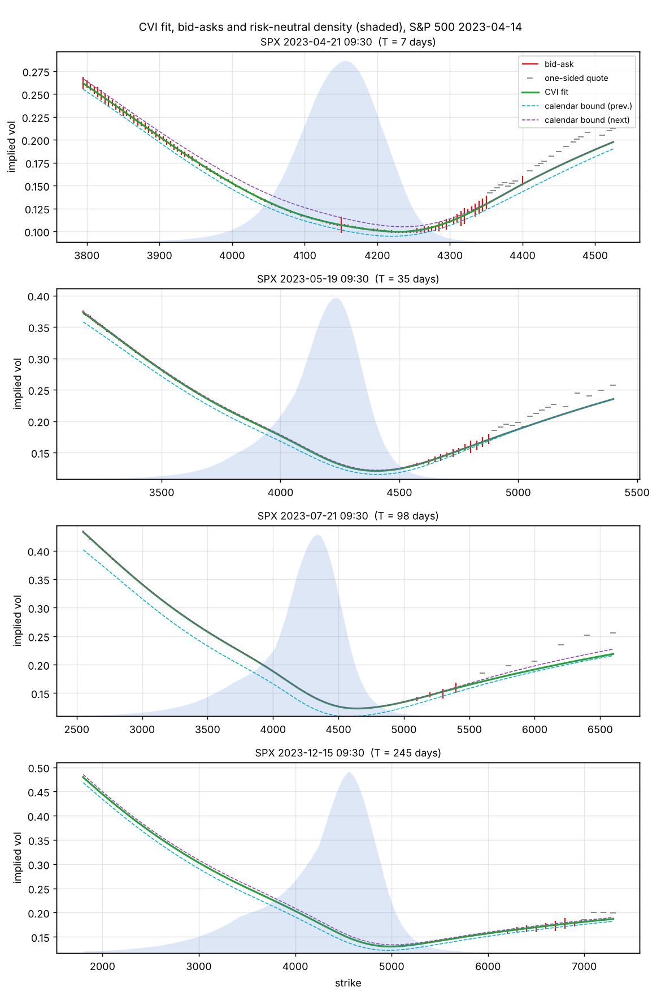
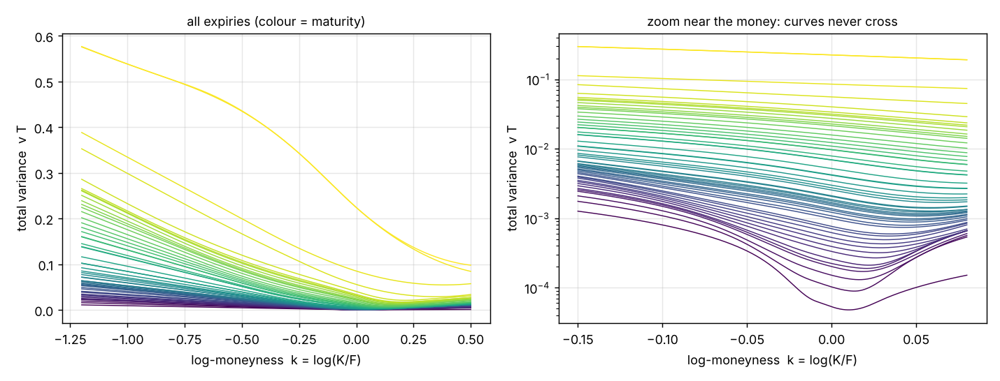
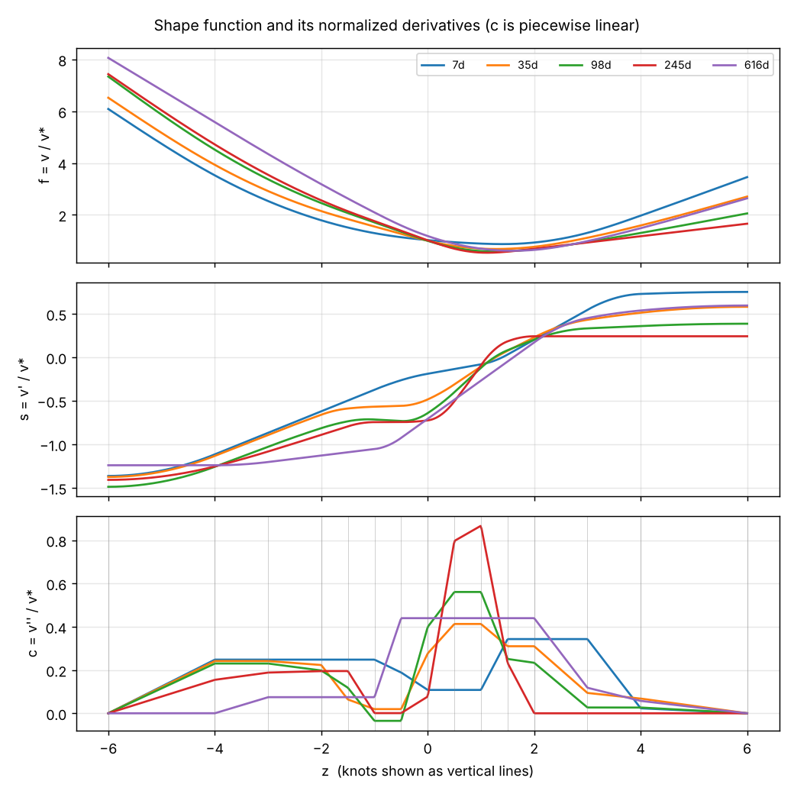

# CVI

Implementation of **Convex Volatility Interpolation** — Fabrice Deschâtres,
[SSRN 4831218](https://papers.ssrn.com/sol3/papers.cfm?abstract_id=4831218)
(Risk, Cutting Edge, February 2026).

The implied variance of each expiry is a cubic spline in the normalized
log-moneyness `z = log(K/F) / (sigma_star sqrt(T))`, with two equivalent
parameterizations linked by a linear map:

- **physical** (`CviRealParams`): ATM variance, ATM skew and the convexity at each knot;
- **B-spline** (`CviCubicBSplineParams`): the weights of the cubic B-spline basis.

The whole surface is calibrated by a sequence of convex QPs solved directly
with [Clarabel](https://github.com/oxfordcontrol/Clarabel.rs) (no modelling layer):

| Paper | Implementation (`cvi/fitter/fitter.py`) |
|---|---|
| Least squares on mid variance, weights `1/(v_ask - v_bid)^2`, scaled per expiry | ✅ |
| Above-ask / below-bid penalties, vega weights normalized by `q_j` | ✅ (one-sided quotes by default, `bid_ask_penalty_scope="all"` for every quote) |
| Strike regularization `lambda * sum |c_i - c_{i+1}|` (lambda = 0.05) | ✅ (auxiliary variables) |
| Positivity of the variance (first expiry) | ✅ |
| Zero convexity at edge knots, increasing wings (eq. 1) | ✅ |
| Lee's tail slope bounds (eq. 2) | ✅ |
| No calendar spread at fixed `K/F` (eq. 3), in the tails (eq. 4) | ✅ (linear extrapolation outside the knots) |
| Linearized no-butterfly constraints inside (eq. 5) and at the edge knots (eqs. 18, 19) | ✅ (`cvi/fitter/butterfly.py`) |
| First solve without butterfly constraints, then re-linearize until arbitrage-free | ✅ |

## Usage

```python
import pandas as pd
from cvi.fitter.fitter import CviVolFitter
from cvi.fitter.fitter_options import CviVolFitterOptions

chain = pd.read_csv("cvi/examples/data/2023-04-14_vol.csv", parse_dates=["expiry"])
nodes = [-6, -4, -3, -2, -1.5, -1, -0.5, 0, 0.5, 1, 1.5, 2, 3, 4, 6]
result = CviVolFitter().fit(chain, nodes, CviVolFitterOptions())
slc = result.slices[pd.Timestamp("2023-06-16 16:00")]
vol, dvol_dk, d2vol_dk2 = slc.vol_deriv1_deriv2_k(4100.0)
```

`python -m cvi.examples.fit_spx [--plot]` fits the bundled S&P 500 snapshot
(54 expiries, about 9,000 strikes): three Clarabel solves, about 0.8 s of solver
time, no butterfly arbitrage on a 2,001-point grid per expiry, and 99.5% of
the two-sided quotes inside the bid-ask.

## Figures

Generated by `python -m cvi.examples.plots` (written to `docs/images/`).

**Fit, bid-asks and risk-neutral density.** Red bars are two-sided quotes, grey
ticks one-sided quotes, the green curve the CVI fit and the shaded area the
density `d²C/dK²`. Dashed curves are the calendar bounds implied by the previous
and next expiries (the "calendar channel" of the paper).



**Total variance.** One curve per expiry; the curves never cross (no calendar
spread arbitrage).



**Shape function** `f = v / v*` with the normalized skew `s` and convexity `c`.
`c` is piecewise linear between knots; the total-variation penalty makes it
favour plateaus.



## Calibration time versus number of knots

`python -m cvi.examples.benchmark` (compare with Table 1 of the paper). Knots are
spread on `[-6, 6]` with a sinh map, denser near the money, always including
`z = 0`. "bfly viol." is the number of check points with butterfly arbitrage
after each solve.

S&P 500 2023-04-14: 54 expiries fitted, 17,512 vol bids or asks; best of 3 runs; x86_64, 4 logical CPUs

|   knots |   iters | bfly viol.       |   P nnz | A nnz (1st / last)   | constraints (1st / last)   |   solver 1st (s) |   solver total (s) |   wall total (s) | in bid-ask   | status   |
|--------:|--------:|:-----------------|--------:|:---------------------|:---------------------------|-----------------:|-------------------:|-----------------:|:-------------|:---------|
|       5 |       5 | 2399→166→11→31→0 |    1952 | 40,024 / 141,516     | 6,730 / 32,526             |            0.084 |              2.141 |             2.73 | 31.0%        | ok       |
|      10 |       2 | 396→0            |    2738 | 42,724 / 60,931      | 7,270 / 11,986             |            0.138 |              0.342 |             0.76 | 96.5%        | ok       |
|      15 |       4 | 442→65→7→0       |    3608 | 45,424 / 103,291     | 7,810 / 22,972             |            0.175 |              1.29  |             2.04 | 99.5%        | ok       |
|      20 |       2 | 366→0            |    4391 | 48,124 / 67,832      | 8,350 / 13,576             |            0.205 |              0.505 |             0.9  | 99.5%        | ok       |
|      30 |       2 | 337→0            |    6036 | 53,524 / 74,736      | 9,430 / 15,167             |            0.242 |              0.607 |             1.04 | 99.5%        | ok       |
|      40 |       3 | 231→7→0          |    7637 | 58,924 / 103,744     | 10,510 / 22,852            |            0.338 |              1.514 |             2.15 | 99.5%        | ok       |
|      80 |       3 | 262→7→0          |   13650 | 80,524 / 138,550     | 14,830 / 31,554            |            1.105 |              3.899 |             4.92 | 99.5%        | ok       |

- From 10 knots on, the surface is arbitrage free after 2 or 3 solves, as in the
  paper. Five knots are too few for this snapshot (31% of quotes inside the
  bid-ask) and need five solves.
- The constraint count grows across solves because the linearized butterfly
  constraints of earlier solves are kept (`accumulate_butterfly_cuts`) and points
  found in violation are added to the constraint grid.
- Solver time grows roughly linearly up to about 40 knots and faster beyond, the
  same pattern as the paper. Absolute times are about 3 to 10 times the paper's
  (0.15 s for 20 knots on 46 SPX expiries). This snapshot has more expiries (54),
  uses 40 calendar and about 60 butterfly points per expiry instead of 20, and
  runs on a different machine (4 logical CPUs here).
- "wall total" includes building the problem in Python, which is not optimized.

## Notes

- Constraints are imposed on finite grids (`n_*_points` options), as in the paper;
  tiny violations between grid points are possible. The butterfly grid always
  includes the interior knots and a denser set in the two edge segments, and
  check points found in violation after a solve are added to it.
- Re-linearizing at the previous solution only (the paper's description) can
  cycle when the butterfly bound is convex in the skew; keeping the earlier
  linearizations as cutting planes (default) removes the cycling in our tests.
- Quotes whose bid vol is above the ask vol (from mixing call and put quotes)
  are ignored; expiries shorter than `min_t_e` are dropped.
- The trader-facing skew of `CviRealParams(atm_var, skew, nodes)` is
  `-100 * dv/dz`; it is stored internally as `dv/dz`.

## Tests

```bash
pytest
```

`tests/test_butterfly.py` reproduces Table 2 (Appendix C) of the paper.
